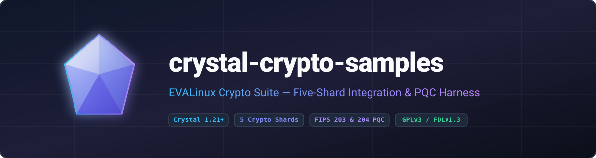

**End-to-end integration harness and demonstration suite for the EVALinux Crypto Suite (CBOR FIDO, ECC Constant, PQC Constant, DBus Native, and TPM2 TSS).**

[](https://gitlab.com/renich/crystal-crypto-samples/-/releases)
[](https://crystal-lang.org/)
[](https://gitlab.com/renich/crystal-crypto-samples/-/pipelines)
[](https://gitlab.com/renich/crystal-crypto-samples)
[](https://github.com/crystal-ameba/ameba)
[](https://github.com/kdairatchi/flaw)

[](https://renich.gitlab.io/crystal-crypto-samples/)
[](https://renich.gitlab.io/crystal-crypto-samples/technical/api/)
[](LICENSE)
[](https://liberapay.com/Renich/donate)

> **GitLab Project Metadata**:
> - **Description**: End-to-end integration harness and demonstration suite for the EVALinux Crypto Suite (CBOR FIDO, ECC Constant, PQC Constant, DBus Native, and TPM2 TSS).
> - **Topics and Tags**: `crystal`, `crystal-lang`, `cryptography`, `post-quantum-cryptography`, `fido2`, `tpm2`, `dbus`, `cbor`, `ed25519`, `ml-kem`, `ml-dsa`, `gplv3`

---

## The Crypto Suite Shards

This sample application dynamically links and demonstrates the capabilities of our five standalone shards:

- **[Crystal CBOR FIDO](https://gitlab.com/renich/crystal-cbor-fido)** (`~> 0.2.1`): Memory-safe Canonical CBOR (RFC 8949 §4.2/CTAP2 §6) encoder and decoder with canonical IEEE 754 float narrowing and trailing-byte rejection.
- **[Crystal DBus Native](https://gitlab.com/renich/crystal-dbus-native)** (`~> 0.3.0`): Native, zero-dependency D-Bus wire protocol featuring general-purpose `BodyCodec` (`Variant`, `StructValue`, `a{sv}`), `HeaderCodec`, SASL `EXTERNAL` authentication, and `SCM_RIGHTS` file descriptor passing.
- **[Crystal ECC Constant](https://gitlab.com/renich/crystal-ecc-constant)** (`~> 0.2.1`): Strictly constant-time classical Elliptic Curve Cryptography (`Ed25519` signatures and `X25519` ECDH) backed by `libsodium` secure memory and `sodium_mprotect_readonly` page protection.
- **[Crystal PQC Constant](https://gitlab.com/renich/crystal-pqc-constant)** (`~> 0.1.0`): Constant-time Post-Quantum Cryptography implementing NIST FIPS 203 `ML-KEM` (`ML-KEM-512`, `ML-KEM-768`, `ML-KEM-1024`) and NIST FIPS 204 `ML-DSA` (`ML-DSA-44`, `ML-DSA-65`, `ML-DSA-87`) backed by OpenSSL 3.5+ `EVP_PKEY` and `libsodium` guarded memory.
- **[Crystal TPM2 TSS](https://gitlab.com/renich/crystal-tpm2-tss)** (`~> 0.4.0`): Native TPM 2.0 Software Stack featuring hardware NV storage key persistence, real OpenSSL 3.5 NIST P-256 key generation and ECDSA verification (`TPM2_ReadPublic`), KDFa `XOR` and `AES-128-CFB` parameter encryption, TCG `cpHash`/`rpHash` calculation, and $\mathcal{O}(1)$ atomic nonce-reuse detection.

---

## Post-Quantum Cryptography in the Suite

Post-Quantum Cryptography (PQC) is provided as a dedicated, standalone shard—**[crystal-pqc-constant](https://gitlab.com/renich/crystal-pqc-constant)**—and demonstrated directly in `CrystalCryptoSamples.run_pqc_sample`:

- **Why PQC Is Required**: Classical public-key algorithms (`Ed25519` and `X25519` in `crystal-ecc-constant`, as well as hardware-bound `NIST P-256` in `crystal-tpm2-tss`) rely on the hardness of the Elliptic Curve Discrete Logarithm Problem (ECDLP). A Cryptographically Relevant Quantum Computer (CRQC) executing Shor's algorithm can solve ECDLP in polynomial time, threatening both historical key-agreement transcripts ("harvest now, decrypt later") and long-lived digital signatures.
- **NIST FIPS 203 `ML-KEM` Key Encapsulation**: `Crystal::Pqc::Constant::MLKEMKeyPair` implements Module-Lattice-Based Key-Encapsulation (`MLKEM512`, `MLKEM768`, `MLKEM1024`) based on the hardness of the Module Learning With Errors (MLWE) problem over polynomial rings. Decapsulation uses **implicit rejection**—deriving a pseudorandom fallback secret rather than branching or returning an error when a ciphertext is tampered—eliminating adaptive chosen-ciphertext timing side channels.
- **NIST FIPS 204 `ML-DSA` Digital Signatures**: `Crystal::Pqc::Constant::MLDSAKeyPair` implements Module-Lattice-Based Digital Signatures (`MLDSA44`, `MLDSA65`, `MLDSA87`) based on the combined hardness of MLWE and Module Short Integer Solution (MSIS) lattice problems, providing strongly unforgeable digital signatures without elliptic-curve number theory.
- **Guarded Memory & Constant-Time Discipline**: Post-quantum secret keys (`1,632`–`4,896` bytes) and `32`-byte shared secrets are isolated outside Crystal's garbage-collected heap inside `libsodium` `sodium_malloc` guarded allocations (`mlock` + canary + guard page) and locked `PROT_READ` via `sodium_mprotect_readonly`. Ephemeral shared secrets are consumed through `SharedSecret#consume`, which automatically wipes and frees the guarded page on block exit.

---

## Getting Started

### Installation & Prerequisites

Ensure host dependencies are installed (`libsodium-devel` and `openssl-devel` >= 3.5 on Fedora/RHEL):

```bash
# Clone the repository
git clone git@gitlab.com:renich/crystal-crypto-samples.git
cd crystal-crypto-samples

# Install shard dependencies
shards install
```

### Running the Integration Sample

```bash
make build
./bin/crystal-crypto-samples
```

The sample runner executes five self-contained integration demonstrations:

1. **CBOR FIDO (`run_cbor_sample`)**: Canonical map key ordering, `UInt64` serialization, and canonical IEEE 754 `Float16` narrowing (`1.5_f64` -> `f93e00`).
2. **ECC Constant (`run_ecc_sample`)**: Constant-time `Ed25519` detached signatures and mutual `X25519` ECDH shared secret agreement (`SharedSecret#consume` + `Sodium.constant_time_equal?`) with deterministic `sodium_malloc` disposal.
3. **PQC Constant (`run_pqc_sample`)**: Post-quantum NIST FIPS 203 `ML-KEM-768` key encapsulation (`1,184`-byte public key, `1,088`-byte ciphertext, `32`-byte shared secret) and NIST FIPS 204 `ML-DSA-65` lattice signature generation and verification (`1,952`-byte public key, `3,309`-byte signature).
4. **DBus Native (`run_dbus_sample`)**: Recursive `SignatureValidator.validate("a{sv}")`, `BodyCodec` `a{sv}` dictionary marshaling/unmarshaling, SASL `EXTERNAL` authentication, `NEGOTIATE_UNIX_FD` negotiation, and full `org.freedesktop.DBus.Hello` bus registration.
5. **TPM2 TSS (`run_tpm2_sample`)**: Stateful `FIDO2CredentialManager` dynamic NV handle persistence, real OpenSSL 3.5 NIST P-256 public key extraction (`TPM2_ReadPublic`) and ECDSA `(r, s)` signature verification (`FIDO2Credential#verify`) with $\mathcal{O}(1)$ `SignatureRTracker` nonce-reuse verification, plus KDFa `XOR` and `AES-128-CFB` parameter encryption roundtrips.

---

## Build System Targets

The repository includes a standard FHS-compliant `GNUmakefile`:

| Target | Description |
| :--- | :--- |
| `make all` | Runs static linters (`Ameba --all` & `Flaw`), spec suite, and builds binary |
| `make build` | Compiles executable binary in `bin/crystal-crypto-samples` |
| `make test` | Executes the complete Crystal spec suite (`crystal spec --error-trace`) |
| `make lint` | Runs `crystal tool format --check`, `Ameba --all`, and `Flaw` SAST scanner |
| `make doc-check` | Validates all reStructuredText files with `crstlint` and `rstcheck` |
| `make check` | Aggregates `lint`, `test`, and `doc-check` quality gates |
| `make docs` | Generates Crystal API docs and Sphinx `dirhtml` documentation portal |
| `make install` | Installs binary and documentation to `$(DESTDIR)$(PREFIX)` |
| `make clean` | Removes build artifacts and generated documentation |
| `make distclean` | Removes all build outputs and installed shard dependencies |

---

## Documentation

Full architectural blueprints, functional specifications, and operational playbooks are maintained under [`docs/`](docs/index.rst):

| Guide | Scope & Highlights | Entry Point |
| :--- | :--- | :--- |
| **Business Context & Strategy** | Ecosystem problem statement, cross-shard validation goals, and personas. | [Business Specs](docs/business/spec.rst) |
| **Functional Specifications** | Requirements `[FUNC-001]`–`[FUNC-007]` and behavioral contracts. | [Functional Specs](docs/functional/spec.rst) |
| **Technical Architecture** | Specifications `[TECH-001]`–`[TECH-007]`, D2 topology, and threat modeling. | [Technical Specs](docs/technical/spec.rst) |
| **Release Playbook** | SemVer, Keep a Changelog, and GPG-signed GitLab release steps. | [Release Procedure](docs/technical/specs/release-procedure.rst) |
| **Architecture Decisions (ADRs)** | Immutable logs of architectural decisions and trade-offs. | [ADR Index](docs/adrs/index.rst) |
| **Project Roadmap** | Phased milestone tracking, D2 dependency graphs, and critical paths. | [Project Roadmap](docs/project/roadmap.rst) |
| **User Guides** | Prerequisites, installation, and CLI execution instructions. | [User Manual](docs/user/index.rst) |
| **Crystal API Reference** | Compiler-generated API reference for `CrystalCryptoSamples`. | [API Reference](https://renich.gitlab.io/crystal-crypto-samples/technical/api/) |

---

## Contributing & Code of Honor

All contributions must adhere to the [Universal Code of Honor](CODE_OF_HONOR.rst) and [Contributing Guidelines](CONTRIBUTING.rst).

---

## License

- **Software**: GNU General Public License v3.0 or later ([LICENSE](LICENSE)).
- **Documentation**: GNU Free Documentation License v1.3 or later ([LICENSE-DOCS](LICENSE-DOCS)).

Copyleft © 2026 Rénich Bon Ćirić <renich@evalinux.com>.

---

## Support & Donations

If you find this project useful and wish to support its ongoing development, please consider donating:

[](https://liberapay.com/Renich/donate)
