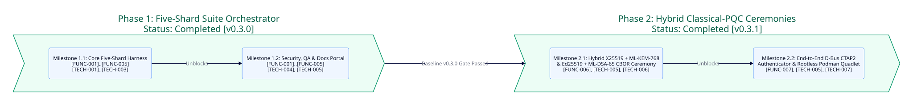

===============
Project Roadmap
===============

This roadmap tracks the phased delivery, dependency sequencing, and bidirectional requirement traceability for ``crystal-crypto-samples``.

Macro Execution Timeline
------------------------

Phase Summary
-------------

.. list-table::
   :widths: 22 18 32 28
   :header-rows: 1

   * - Phase
     - Status
     - Scope Summary
     - Traceability IDs
   * - :doc:`roadmaps/phase-1-mvp`
     - Completed ``v0.3.0``
     - Five-Shard Suite Orchestrator, guarded memory disposal, secret redaction, and ``IO::Memory`` spec harness
     - ``[FUNC-001]``..``[FUNC-005]``, ``[TECH-001]``..``[TECH-005]``
   * - :doc:`roadmaps/phase-2-enhancement`
     - Planned ``v0.4.0``
     - Hybrid ``X25519 + ML-KEM-768`` and ``Ed25519 + ML-DSA-65`` CBOR ceremony, D-Bus CTAP2 authenticator service, and rootless Podman Quadlet
     - ``[FUNC-006]``, ``[FUNC-007]``, ``[TECH-005]``, ``[TECH-006]``, ``[TECH-007]``

.. toctree::
   :maxdepth: 2
   :caption: Execution Phases

   roadmaps/phase-1-mvp
   roadmaps/phase-2-enhancement
   audits/index
