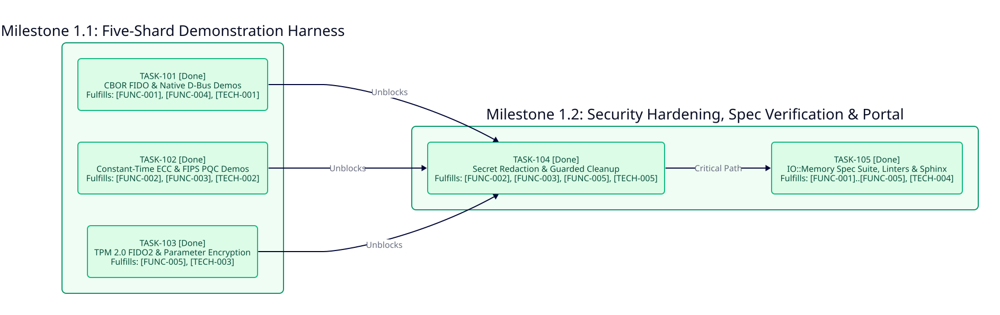

======================================
Phase 1: Five-Shard Suite Orchestrator
======================================

- **Status**: Completed in ``v0.3.0``
- **Target Scope**: ``[FUNC-001]``, ``[FUNC-002]``, ``[FUNC-003]``, ``[FUNC-004]``, ``[FUNC-005]``, ``[TECH-001]``, ``[TECH-002]``, ``[TECH-003]``, ``[TECH-004]``, ``[TECH-005]``

Phase 1 Dependency Graph
------------------------

Milestone 1.1: Five-Shard Demonstration Harness
-----------------------------------------------

Deliver side-effect-isolated demonstration methods for all five standalone shards in ``src/crystal_crypto_samples.cr``.

``TASK-101`` Canonical CBOR FIDO and Native D-Bus Demonstrations
~~~~~~~~~~~~~~~~~~~~~~~~~~~~~~~~~~~~~~~~~~~~~~~~~~~~~~~~~~~~~~~~

* **Status**: Completed ``[x]``
* **Fulfills**: ``[FUNC-001]``, ``[FUNC-004]``, ``[TECH-001]``
* **Blocked By**: None
* **Unblocks**: ``TASK-104``
* **Deliverables**: Implement ``CrystalCryptoSamples.run_cbor_sample`` exercising canonical map key sorting, ``UInt64`` serialization, and IEEE 754 ``Float16`` narrowing ``f93e00``, alongside ``CrystalCryptoSamples.run_dbus_sample`` exercising ``SignatureValidator.validate("a{sv}")``, ``BodyCodec`` ``a{sv}`` marshaling, SASL ``EXTERNAL``, ``NEGOTIATE_UNIX_FD``, and ``org.freedesktop.DBus.Hello``.

``TASK-102`` Classical Constant-Time ECC and NIST Post-Quantum Demonstrations
~~~~~~~~~~~~~~~~~~~~~~~~~~~~~~~~~~~~~~~~~~~~~~~~~~~~~~~~~~~~~~~~~~~~~~~~~~~~~

* **Status**: Completed ``[x]``
* **Fulfills**: ``[FUNC-002]``, ``[FUNC-003]``, ``[TECH-002]``
* **Blocked By**: None
* **Unblocks**: ``TASK-104``
* **Deliverables**: Implement ``CrystalCryptoSamples.run_ecc_sample`` exercising ``Ed25519`` detached signatures and mutual ``X25519`` ECDH agreement, and ``CrystalCryptoSamples.run_pqc_sample`` exercising NIST FIPS 203 ``ML-KEM-768`` encapsulation and NIST FIPS 204 ``ML-DSA-65`` signatures in guarded memory.

``TASK-103`` TPM 2.0 FIDO2 Persistence and Parameter Encryption Demonstration
~~~~~~~~~~~~~~~~~~~~~~~~~~~~~~~~~~~~~~~~~~~~~~~~~~~~~~~~~~~~~~~~~~~~~~~~~~~~~

* **Status**: Completed ``[x]``
* **Fulfills**: ``[FUNC-005]``, ``[TECH-003]``
* **Blocked By**: None
* **Unblocks**: ``TASK-104``
* **Deliverables**: Implement ``CrystalCryptoSamples.run_tpm2_sample`` exercising ``FIDO2CredentialManager`` dynamic NV handle persistence, ``TPM2_ReadPublic`` NIST P-256 ECDSA verification, ``SignatureRTracker``, and KDFa ``XOR`` and ``AES-128-CFB`` parameter encryption roundtrips with ``IO`` stream injection.

Milestone 1.2: Security Hardening, Spec Verification, and Documentation Portal
------------------------------------------------------------------------------

Enforce cryptographic secret redaction, deterministic ``ensure`` disposal, and automated quality gates.

``TASK-104`` Secret Redaction and Deterministic Guarded Memory Cleanup
~~~~~~~~~~~~~~~~~~~~~~~~~~~~~~~~~~~~~~~~~~~~~~~~~~~~~~~~~~~~~~~~~~~~~~

* **Status**: Completed ``[x]``
* **Fulfills**: ``[FUNC-002]``, ``[FUNC-003]``, ``[FUNC-005]``, ``[TECH-005]``
* **Blocked By**: ``TASK-101``, ``TASK-102``, ``TASK-103``
* **Unblocks**: ``TASK-105``
* **Deliverables**: Redact derived TPM 2.0 auth key bytes from ``IO`` logs, enforce ``SharedSecret#consume`` + ``Sodium.constant_time_equal?`` for all shared-secret comparisons, and wrap all keypairs and ``UNIXSocket.pair`` endpoints in ``ensure`` cleanup blocks.

``TASK-105`` Stream-Injected Spec Suite, Static Analysis, and Sphinx Portal
~~~~~~~~~~~~~~~~~~~~~~~~~~~~~~~~~~~~~~~~~~~~~~~~~~~~~~~~~~~~~~~~~~~~~~~~~~~

* **Status**: Completed ``[x]``
* **Fulfills**: ``[FUNC-001]``, ``[FUNC-002]``, ``[FUNC-003]``, ``[FUNC-004]``, ``[FUNC-005]``, ``[TECH-004]``
* **Blocked By**: ``TASK-104``
* **Unblocks**: Phase 2 ``TASK-201``
* **Deliverables**: Verify all 7 unit and integration specs in ``spec/crystal_crypto_samples_spec.cr`` via ``IO::Memory``, enforce zero warnings across ``ameba --all``, ``flaw``, ``crstlint``, and ``rstcheck``, and compile the Sphinx ``dirhtml`` + Crystal API documentation portal.

Critical Path
-------------

``{TASK-101, TASK-102, TASK-103} -> TASK-104 -> TASK-105``
