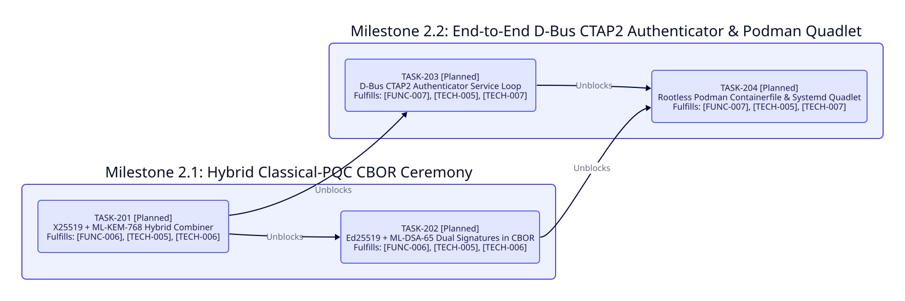

========================================
Phase 2: Hybrid Classical-PQC Ceremonies
========================================

- **Status**: Completed in ``v0.3.1``
- **Target Scope**: ``[FUNC-006]``, ``[FUNC-007]``, ``[TECH-005]``, ``[TECH-006]``, ``[TECH-007]``

Phase 2 Dependency Graph
------------------------

Milestone 2.1: Hybrid X25519 + ML-KEM-768 and Ed25519 + ML-DSA-65 CBOR Ceremony
-------------------------------------------------------------------------------

Deliver a composite classical and post-quantum key agreement and dual-signature ceremony serialized in canonical CTAP2 CBOR.

``TASK-201`` Hybrid X25519 and ML-KEM-768 Key Encapsulation Combiner
~~~~~~~~~~~~~~~~~~~~~~~~~~~~~~~~~~~~~~~~~~~~~~~~~~~~~~~~~~~~~~~~~~~~

* **Status**: Completed ``[x]``
* **Fulfills**: ``[FUNC-006]``, ``[TECH-005]``, ``[TECH-006]``
* **Blocked By**: Phase 1 ``TASK-105``
* **Unblocks**: ``TASK-202``, ``TASK-203``
* **Deliverables**: Implement guarded hybrid key encapsulation combining ``Crystal::Ecc::Constant::X25519KeyPair`` and ``Crystal::Pqc::Constant::MLKEMKeyPair`` inside nested ``SharedSecret#consume`` blocks with ``SHA256("EVALINUX-HYBRID-KEM-V1" || x25519_ss || mlkem768_ss || transcript_cbor)`` key derivation and constant-time equality verification.

``TASK-202`` Composite Ed25519 and ML-DSA-65 Dual Signatures in Canonical CBOR
~~~~~~~~~~~~~~~~~~~~~~~~~~~~~~~~~~~~~~~~~~~~~~~~~~~~~~~~~~~~~~~~~~~~~~~~~~~~~~

* **Status**: Completed ``[x]``
* **Fulfills**: ``[FUNC-006]``, ``[TECH-005]``, ``[TECH-006]``
* **Blocked By**: ``TASK-201``
* **Unblocks**: ``TASK-204``
* **Deliverables**: Implement ``CrystalCryptoSamples.run_hybrid_pqc_sample(io : IO = STDOUT) : Nil`` serializing the hybrid public-key transcript ``{1_i64 => "EVALINUX-HYBRID-V1", 2_i64 => x25519_pub, 3_i64 => mlkem768_pub, 4_i64 => mlkem768_ct}`` and dual-signature assertion ``{1_i64 => transcript_cbor, 2_i64 => ed25519_sig, 3_i64 => mldsa65_sig}`` via ``Crystal::Cbor::Fido`` and verifying both signatures deterministically.

Milestone 2.2: End-to-End D-Bus CTAP2 Authenticator and Rootless Podman Quadlet
-------------------------------------------------------------------------------

Deliver an in-memory D-Bus CTAP2 authenticator service loop combining all five shards plus rootless container packaging.

``TASK-203`` End-to-End D-Bus CTAP2 Authenticator Service Loop
~~~~~~~~~~~~~~~~~~~~~~~~~~~~~~~~~~~~~~~~~~~~~~~~~~~~~~~~~~~~~~

* **Status**: Completed ``[x]``
* **Fulfills**: ``[FUNC-007]``, ``[TECH-005]``, ``[TECH-007]``
* **Blocked By**: ``TASK-201``
* **Unblocks**: ``TASK-204``
* **Deliverables**: Implement ``CrystalCryptoSamples.run_ctap2_dbus_sample(io : IO = STDOUT) : Nil`` transporting canonical CBOR ``MakeCredential`` requests with D-Bus signature ``ay`` -> ``ay`` over object path ``/org/evalinux/Ctap2Authenticator1`` and interface ``org.evalinux.Ctap2Authenticator1`` on an authenticated ``Crystal::Dbus::Native::DBusConnection`` to a responder fiber backed by ``Crystal::Tpm2::Tss::FIDO2CredentialManager`` and ``Crystal::Pqc::Constant::MLDSAKeyPair``.

``TASK-204`` Rootless Podman Containerfile and Systemd Quadlet Integration
~~~~~~~~~~~~~~~~~~~~~~~~~~~~~~~~~~~~~~~~~~~~~~~~~~~~~~~~~~~~~~~~~~~~~~~~~~

* **Status**: Completed ``[x]``
* **Fulfills**: ``[FUNC-007]``, ``[TECH-005]``, ``[TECH-007]``
* **Blocked By**: ``TASK-202``, ``TASK-203``
* **Unblocks**: Release ``v0.3.1``
* **Deliverables**: Author ``containers/Containerfile`` and ``containers/crystal-crypto-samples.container`` systemd Quadlet unit aligned with ``../init/app``, and add ``containers-build`` and ``containers-run`` targets to ``GNUmakefile``.

Critical Path
-------------

``TASK-201 -> {TASK-202, TASK-203} -> TASK-204``
