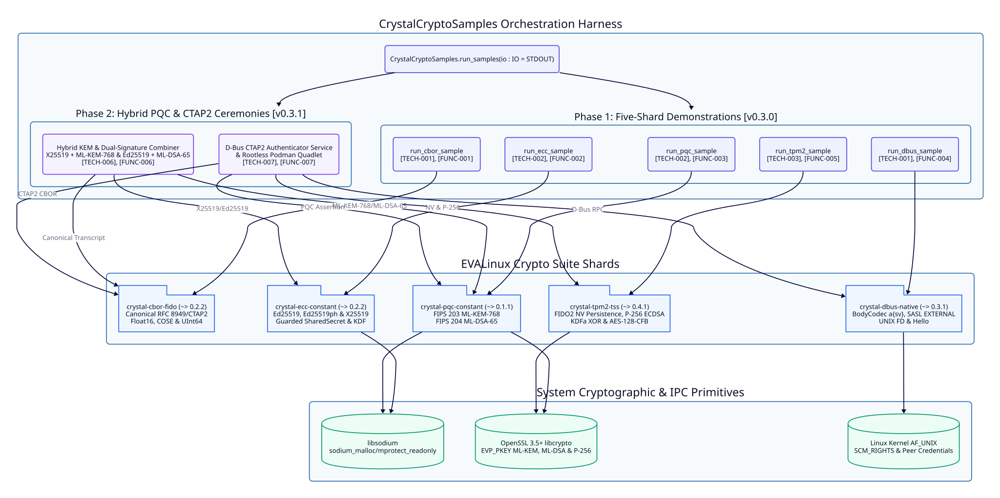

=====================
Architecture Overview
=====================

Requirement Mapping
-------------------

Fulfills ``[FUNC-001]``, ``[FUNC-002]``, ``[FUNC-003]``, ``[FUNC-004]``, ``[FUNC-005]``, ``[FUNC-006]``, ``[FUNC-007]`` defined in :doc:`../../functional/specs/core-requirements`.

System Topology
---------------

``CrystalCryptoSamples`` orchestrates all five standalone shards in the EVALinux Crypto Suite through isolated, stream-injected demonstration routines.

Phase 1 Architecture for v0.3.0
-------------------------------

``[TECH-001]`` Wire Protocol Serialization and D-Bus Orchestration
~~~~~~~~~~~~~~~~~~~~~~~~~~~~~~~~~~~~~~~~~~~~~~~~~~~~~~~~~~~~~~~~~~

* **Fulfills**: ``[FUNC-001]``, ``[FUNC-004]``

``CrystalCryptoSamples.run_cbor_sample`` exercises ``Crystal::Cbor::Fido`` by constructing a ``Hash(Crystal::Cbor::Fido::Value, Crystal::Cbor::Fido::Value)`` containing heterogeneous CTAP2 types: UTF-8 strings, signed 64-bit integers, the maximum unsigned 64-bit integer ``18_446_744_073_709_551_615_u64``, and a floating-point value ``1.5_f64`` that narrows losslessly to IEEE 754 ``Float16`` bytes ``f93e00``.

``CrystalCryptoSamples.run_dbus_sample`` exercises ``Crystal::Dbus::Native`` across three layers:

#. Recursive type signature validation via ``SignatureValidator.validate("a{sv}")``.
#. General-purpose ``BodyCodec.encode`` and ``BodyCodec.decode`` roundtrip marshaling of an ``a{sv}`` dictionary containing a boxed ``Variant("u", 42_u32)``.
#. Full wire-level authentication and bus registration over an in-memory ``UNIXSocket.pair(Socket::Type::STREAM)`` where a background responder fiber services SASL ``EXTERNAL``, ``NEGOTIATE_UNIX_FD``, and ``org.freedesktop.DBus.Hello`` requests from ``DBusConnection#start``.

``[TECH-002]`` Classical and Post-Quantum Guarded Memory Orchestration
~~~~~~~~~~~~~~~~~~~~~~~~~~~~~~~~~~~~~~~~~~~~~~~~~~~~~~~~~~~~~~~~~~~~~~

* **Fulfills**: ``[FUNC-002]``, ``[FUNC-003]``

``CrystalCryptoSamples.run_ecc_sample`` and ``CrystalCryptoSamples.run_pqc_sample`` validate side-by-side linking of ``libsodium`` and OpenSSL 3.5+ ``libcrypto`` within the same process address space:

* **Classical ECC**: ``Ed25519KeyPair.generate`` signs and verifies an assertion payload in constant time. Two ``X25519KeyPair`` instances compute mutual Diffie-Hellman shared secrets and compare them inside nested ``SharedSecret#consume`` blocks via ``Crystal::Ecc::Constant::Sodium.constant_time_equal?``.
* **Post-Quantum Lattice Cryptography**: ``MLKEMKeyPair.generate`` executes NIST FIPS 203 ``ML-KEM-768`` key encapsulation and decapsulation, verifying equality of the 32-byte shared secrets inside nested ``SharedSecret#consume`` blocks via ``Crystal::Pqc::Constant::Sodium.constant_time_equal?``. ``MLDSAKeyPair.generate`` signs and verifies a 3,309-byte NIST FIPS 204 ``ML-DSA-65`` signature over a FIDO2 assertion message.

``[TECH-003]`` TPM 2.0 FIDO2 Credential Persistence and Stream Injection
~~~~~~~~~~~~~~~~~~~~~~~~~~~~~~~~~~~~~~~~~~~~~~~~~~~~~~~~~~~~~~~~~~~~~~~~

* **Fulfills**: ``[FUNC-005]``

``CrystalCryptoSamples.run_tpm2_sample`` instantiates ``Crystal::Tpm2::Tss::TPMDevice`` and ``FIDO2CredentialManager`` to provision a hardware-bound credential persisted in dynamic NV index handles starting at ``0x81010000``. It signs a 32-byte digest under ``SignatureRTracker`` nonce-reuse protection, extracts the real NIST P-256 public key coordinates via ``TPM2_ReadPublic``, and cryptographically verifies the ``(r, s)`` ECDSA signature via ``FIDO2Credential#verify``. It then executes KDFa ``XOR`` and ``AES-128-CFB`` parameter encryption roundtrips on the 32-byte auth value while redacting raw key bytes from the ``IO`` log stream.

Every public entrypoint in ``CrystalCryptoSamples`` accepts ``io : IO = STDOUT`` so that ``spec/crystal_crypto_samples_spec.cr`` injects ``IO::Memory`` to assert on exact output transcripts without writing to terminal ``STDOUT``.

Phase 2 Target Architecture for v0.4.0
--------------------------------------

``[TECH-006]`` Hybrid Classical-PQC Combiner and Canonical CBOR Transcript
~~~~~~~~~~~~~~~~~~~~~~~~~~~~~~~~~~~~~~~~~~~~~~~~~~~~~~~~~~~~~~~~~~~~~~~~~~

* **Fulfills**: ``[FUNC-006]``

Phase 2 introduces ``CrystalCryptoSamples.run_hybrid_pqc_sample(io : IO = STDOUT) : Nil`` to demonstrate a quantum-resistant hybrid cryptographic ceremony:

#. **Canonical CBOR Public-Key Transcript**: Ephemeral ``X25519KeyPair`` and ``MLKEMKeyPair`` instances execute parallel classical ECDH and post-quantum ``ML-KEM-768`` encapsulation. The public parameters and ciphertext are serialized into a canonical integer-keyed CBOR map via ``Crystal::Cbor::Fido.encode`` with the exact schema ``{1_i64 => "EVALINUX-HYBRID-V1", 2_i64 => x25519_pub, 3_i64 => mlkem768_pub, 4_i64 => mlkem768_ct}`` to produce ``transcript_cbor``.
#. **Hybrid Key Encapsulation Combiner**: Both 32-byte ``SharedSecret`` buffers are consumed inside nested ``#consume`` blocks and combined with ``transcript_cbor`` using the exact SHA-256 KDF input construction ``SHA256("EVALINUX-HYBRID-KEM-V1" || x25519_ss || mlkem768_ss || transcript_cbor)`` without copying raw secret slices onto the GC heap.
#. **Composite Dual-Signature Assertion**: ``transcript_cbor`` is signed with both ``Ed25519KeyPair#sign`` and ``MLDSAKeyPair#sign``. Both signatures are serialized into the canonical integer-keyed CBOR assertion map ``{1_i64 => transcript_cbor, 2_i64 => ed25519_sig, 3_i64 => mldsa65_sig}`` and verified in sequence after decoding via ``Crystal::Cbor::Fido.decode``.

``[TECH-007]`` D-Bus CTAP2 Authenticator Service Loop and Rootless Podman Blueprint
~~~~~~~~~~~~~~~~~~~~~~~~~~~~~~~~~~~~~~~~~~~~~~~~~~~~~~~~~~~~~~~~~~~~~~~~~~~~~~~~~~~

* **Fulfills**: ``[FUNC-007]``

Phase 2 introduces ``CrystalCryptoSamples.run_ctap2_dbus_sample(io : IO = STDOUT) : Nil`` and container packaging:

#. **D-Bus CTAP2 RPC Loop**: Over an authenticated ``UNIXSocket.pair`` ``DBusConnection``, a client fiber encodes a canonical CTAP2 CBOR command frame inside a D-Bus method call to object path ``/org/evalinux/Ctap2Authenticator1``, interface ``org.evalinux.Ctap2Authenticator1``, and method ``MakeCredential`` using the D-Bus signature ``ay`` -> ``ay`` via ``BodyCodec.encode("ay", ...)``. The responder fiber decodes the ``ay`` byte array via ``BodyCodec.decode("ay", ...)`` and ``Crystal::Cbor::Fido.decode``, signs the assertion using ``Crystal::Tpm2::Tss::FIDO2Credential`` and ``Crystal::Pqc::Constant::MLDSAKeyPair``, and returns the canonical CBOR response frame as a D-Bus ``ay`` ``METHOD_RETURN`` message.
#. **Rootless Podman and Systemd Quadlet**: The repository will include ``containers/Containerfile`` for multi-stage Alpine/Fedora rootless builds and ``containers/crystal-crypto-samples.container`` systemd Quadlet configuration aligned with ``../init/app``.
